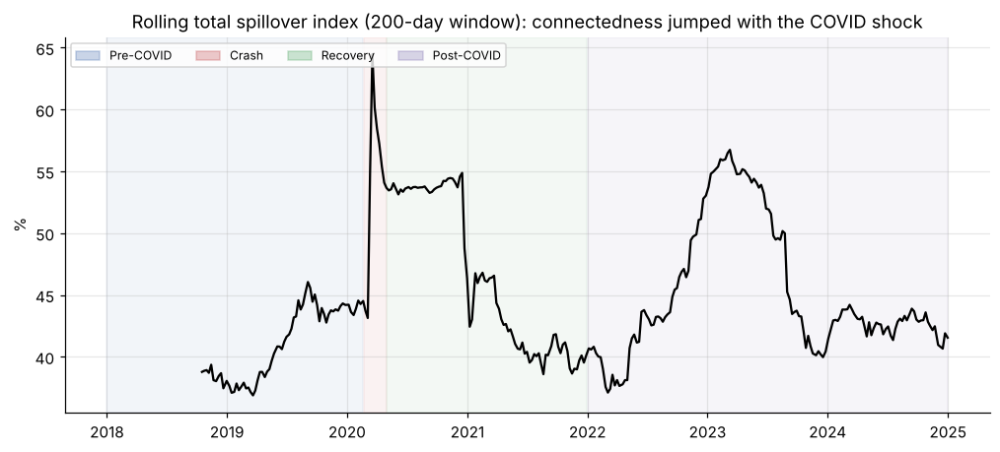
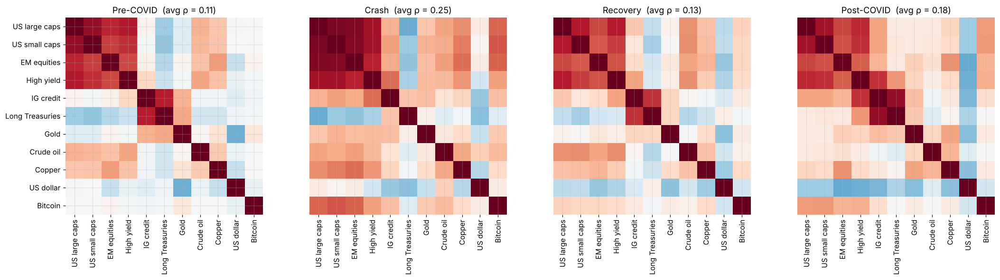
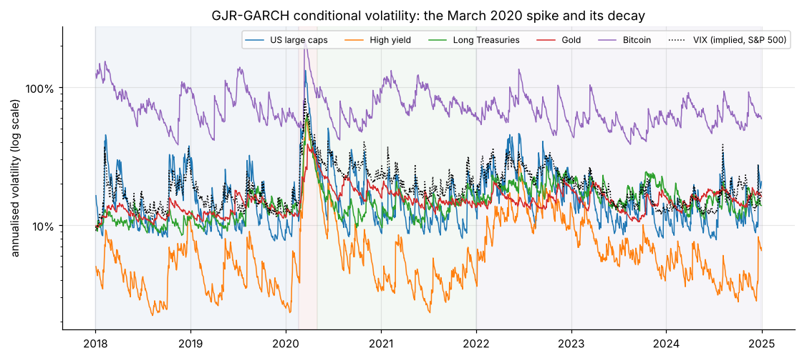
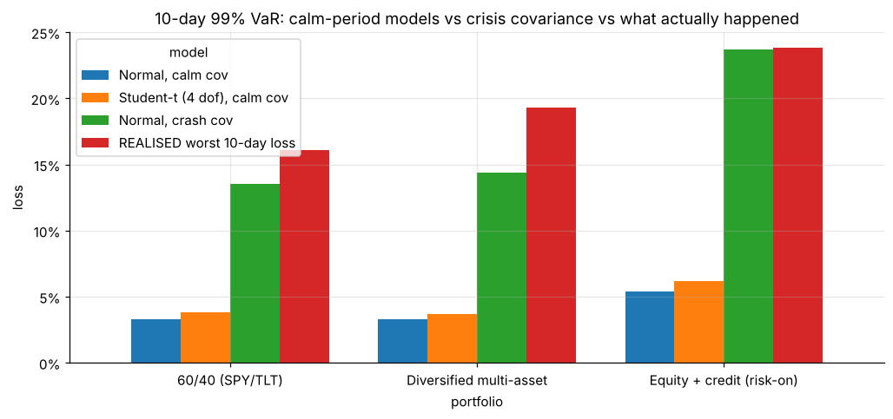
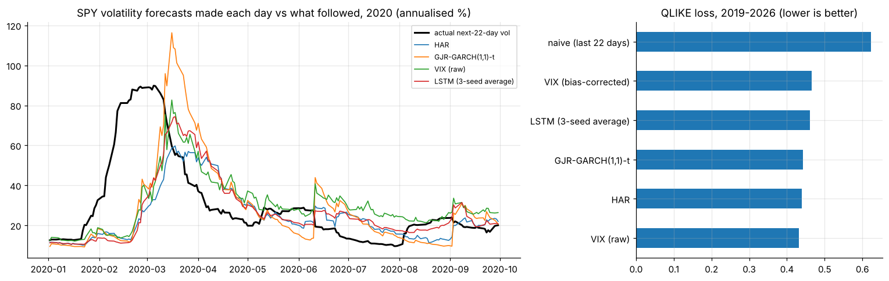

# COVID-19 and Financial Markets: Regimes, Contagion, Volatility and Spillovers

An empirical study of how the COVID-19 shock spread across **15 assets in 6 asset classes** (equities, credit, Treasuries, commodities, FX, crypto and the VIX) from 2018 to 2024. It covers correlation and contagion tests, GJR-GARCH volatility models, Diebold-Yilmaz VAR spillovers, portfolio stress tests and an out-of-sample comparison of volatility forecasts (GARCH, HAR, VIX, LSTM).



## Research questions & findings

| Question | Method | Finding |
|---|---|---|
| How hard was each asset hit? | Period statistics, peak-to-trough drawdowns | Oil (−81%), crypto (−48% to −57%) and small caps (−41%) fell furthest; long Treasuries (+15%) and gold (+5%) gained over the window |
| Did correlations break down? | Regime correlation matrices, rolling correlations | Average pairwise correlation **more than doubled** in the crash (0.11 → 0.25); the stock-bond hedge flipped sign in 2022 |
| Contagion or interdependence? | **Forbes-Rigobon** heteroskedasticity-adjusted correlations + Fisher z-tests | After adjusting for the volatility spike, **no significant contagion**: interdependence, as in earlier crises |
| How did volatility behave? | **GJR-GARCH(1,1)**, Student-t errors; pre- vs post-COVID fits | Strong leverage effect in equities and high yield; post-COVID volatility more persistent, leverage effect weaker |
| Who transmitted the shocks? | **Diebold-Yilmaz** spillover index (VAR + generalised FEVD), rolling | Connectedness rose from ~41% to ~55% in the crash (and surged again in the 2022-23 tightening cycle); equities and high yield are net transmitters |
| Would risk models have coped? | Historical replay; Monte Carlo VaR/ES (normal, Student-t, stressed covariance) | Calm-period 10-day 99% VaR (3-5%) **badly under-predicted** realised losses (16-24%) |
| Could volatility have been forecast? | Naive, **HAR**, GJR-GARCH, VIX and an **LSTM** forecasting next-month SPY volatility daily, 2019-2026; QLIKE and Diebold-Mariano | No model saw the crash coming. The **VIX** was the best forecast overall and in the crash, and the LSTM was no better than HAR (p = 0.74) |

<p float="left">
  
</p>
<p float="left">
  
  
  
</p>

## Notebooks

1. [Market regimes & contagion](notebooks/01_market_regimes_and_contagion.ipynb)
2. [Volatility (GJR-GARCH)](notebooks/02_volatility_garch.ipynb)
3. [VAR spillovers (Diebold-Yilmaz)](notebooks/03_var_spillovers.ipynb)
4. [Stress testing](notebooks/04_stress_testing.ipynb)
5. [Volatility forecasting: GARCH, HAR, VIX and LSTM](notebooks/05_volatility_forecasting.ipynb)

## Quick start

```bash
git clone https://github.com/drimranbhatti/covid-market-impact-research.git
cd covid-market-impact-research
pip install -e ".[notebooks,dev]"
pytest                         # 7 tests
python scripts/fetch_data.py   # optional: refresh data/prices.csv
jupyter lab notebooks/
```

```python
from covidmkt import data, spillover, correlation
px = data.load_prices("data/prices.csv"); r = data.log_returns(px)
table, total = spillover.spillover_table(r[["SPY", "TLT", "GC=F", "BTC-USD"]] * 100, lags=2, horizon=10)
```

## Package
`src/covidmkt/`: `data` (assets, periods) · `regimes` · `correlation` (Forbes-Rigobon, Fisher z) · `volatility` (GJR-GARCH) · `spillover` (generalised FEVD, Diebold-Yilmaz, rolling) · `stress` (historical replay, Monte Carlo VaR/ES)

Tests check that generalised FEVD rows sum to 100% and that independent series give near-zero spillover; that the Forbes-Rigobon adjustment is the identity when volatility is unchanged; that GARCH persistence is below 1; and that Monte Carlo VaR matches the closed-form result and grows with fat tails.

## Data
Daily adjusted closes from Yahoo Finance, Jan 2018 – Dec 2024, on the US trading calendar. Crude oil uses the USO ETF because WTI futures traded *below zero* on 20 April 2020, which makes log returns undefined. Notebook 5 uses a longer SPY and VIX history (2000 – October 2026, `spy_vix_2000.csv`).

## References
Forbes & Rigobon, *No Contagion, Only Interdependence* (J. Finance, 2002) · Diebold & Yilmaz, *Better to Give than to Receive* (IJF, 2012) · Pesaran & Shin (1998) · Glosten, Jagannathan & Runkle (1993) · Engle (1982) · Bollerslev (1986)

---
**Author:** Dr. Muhammad Imran Bhatti, PhD (Finance), MScFE · FCMA · [LinkedIn](https://www.linkedin.com/in/drimranbhatti) · [imranbhatti.com](https://imranbhatti.com)

*Developed from my MScFE capstone research on the impact of COVID-19 on financial markets (WorldQuant University). This repository is an independent, rewritten and extended implementation. Research only; not investment advice. MIT licensed.*
